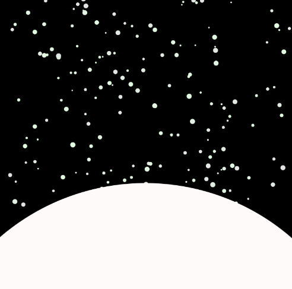

# CART253

## JOURNAL

### September 17 2026

I found that this activity was fairly simple and actually pretty fun. However, I did have a lot of trouble at the beginning when I had to start it, though. It took me at least an hour trying to figure it out because I for some reason thought that Markdown was some sort of extension we needed to download so then I spent a good chunk of time trying to find a suitable one. Then I used the extension even though I wasn't supposed to, and tried to work with it there, but, as expected, it didn't work at all.It took a bit of help and explanations from my friends who had finished their work to understand what I needed to do, after that it became pretty simple. It isn't too difficult once you get the hang of it. I'm excited to see how I use it as we progress further during class! I hope that if I have a future audience, they see how I've grown after taking this course. I'm looking forward to it. I want to take part in making games or do character/concept art in the future so maybe I could make a site for a possible portfolio using what I learned with this assignment. I'm interested in seeing what more we can do with this. I didn't even know that it was possible to make a site with a README file, so it's pretty fascinating to me and it has me wondering what more you could do with other types of files. 

### September 24 2026

I thought the activity was difficult but very fun to do. I couldn't help but feel a bit frustrated at times when I couldn't get the variables right or whenever I ran into errors, but seeing my work at the end always made it worth it. For my prototypes, I decided to do a key for my simple prototype, a close up of a four leaf clover for my abstract prototype, and a character named Chiikawa for my "really weird" prototype (even though Chiikawa isn't weird, but cute!). Originally I had asked for some advice on my four leaf clover and was given some suggestions, but after working on it and seeing how it looked with the suggestions, I decided that it looked fine as is and wanted to keep it how I submitted it. I thought it would be boring to do just a four leaf clover, so I decided to make it look like it was zoomed in by using four triangles and a circle in the middle so it could give the illusion of rounded edges, when in reality it was just four dark green triangles and a lighter green background. It worked out in my favour and I was really pleased with it. For the key, I thought it would be simple enough but still a bit challenging, and it was. I struggled a lot with placing the tips of the key because I kept experimenting with the different placements, but by the end, I got the hang of it. Same goes for my third prototype, it actually took me the least amount of time despite it having the most amount of things to draw, but I was happy it took a shorter amount of time because I didn't have to struggle for too long! 

### October 1 2026

While I was working on this assignment, it was fairly difficult and I had to go through a lot of trial and error to get my prototypes to succeed. I had to go through a ton of hoops to figure out what could work and whether it would fit my vision or not, I ended up completely changing the code for one of my planned variables because I wasn't satisfied with the execution of my idea. For the snowflakes, I ended up using the example code on the p5 website, but I didn't want to completely copy the code so I messed around with it until I was satisfied with how it looked, but if I'm being honest, I didn't feel fulfilled and thought it was a shame that I couldn't understand the actual code being used. It would've been better if I did something that I actually knew how to do instead of finding something that looked cool and following it step by step. It wasn't something I earned. I've always had an odd fascination for storms, including snowstorms, and I guess I just wanted it to look like one, if I had more time I would've remade it completely knowing what I know now. My first variable ended up being something fairly simple, it was just the colour of the background that acted as the sky and a circle that acted as the sun and moon that changed, I wanted to have the ellipse that was the hill change colour too but I couldn't figure out how to implement that, so I picked a colour that wasn't too dark but not too bright so it wouldn't look wholly out of place. The prototype I'm most proud of is the third and final one I worked on. I was aiming for nostalgia and I knew I wanted to do something with my cursor so I thought remaking the DVD logo bouncing off the screen would be fun, and it was one of the things that came to mind that I really liked as an idea so I went for it. I originally had trouble because I kept getting the size of the square wrong and it took a bit to get me to move it around, then after that I didn't know how to change the colour. What I thought was going to be the final was a bright green square you could manually move with your cursor, but it wasn't what I wanted. Then, I had help making the square that was acting as the DVD logo bounce around the square that was the screen and not the border after we learned about conditionals, so it worked out in ways I didn't think it would. I ended up really liking it and was very proud of it!

### October 8 2026

I found this assignment pretty complicated at first, especially in regards to the first prototype I did. The first prototype I did was supposed to represent traffic lights and I had struggled because instead of having the colours pop up when you hovered over each of them, you could only hover over the red light, and then all of the lights would light up instead of just the red circle. I couldn't figure out what was wrong with it so I waited until studio time during class to get some help and found that I had missed something fairly simple and it was a pretty easy fix so it felt pretty worth it to see my vision come to life. I was glad I asked for help instead of mulling over it myself. The same goes for my second prototype because I wanted my animation to come last and I wanted the title first, the ending screen second, and the animation last. I asked for help again, and it took a bit of trial and error to actually make it work, and it was a bit more complicated than I thought it would be, but I was happy that I could get the results I wanted instead of settling for what I had previously. The last prototype was probably the silliest one I had worked on, it was a lot of fun to do the different loot options and come up with different ideas I could put into it. I liked playing around with the percentages and adding more options. It wasn't too difficult for me to do either which I felt pretty happy about because I had a harder time understanding the other two, but this was one was simpler and easy for me to get. I didn't have to rely on something that I didn't learn this time for any of them so I felt pretty proud of myself after finishing the assignment.

### October 22 2026

I had a hard time coming up with what I could do for my prototypes for this assignment, eventually I did come up with a few ideas but they all seemed like they were out of my range. Despite that, I tried my best to do simpler versions to build up on that idea. It did manage to work out, mostly, and I actually ended keeping one of the prototypes that I wanted to change by adding new elements to it. My first prototype was of a button that played an explosion sound when you clicked on it. That was the basic idea that I was able to complete, but I didn't want it to be just that, I originally planned for it to be some kind of game where if you pressed the button, you would get a death screen, and if you waited for ten seconds, you would win. I did have a really hard time implementing that but after receiving some help in class, I was able to figure it out and add the code to complete that idea. My second prototype was the one I needed the least amount of help on, surprisingly. Originally my idea was based off of one of the examples that Pippin showed us in class; Coin Collector. I wanted to do something similar, but instead of just collecting coins, there would be "coins" that would deduct your points, but then I decided that I didn't want to do that, and instead wanted to have one object on the screen constantly switch places, and when you clicked on it you would win. When I started coding it, I messed up and confused myself, which ended up working. Though, I didn't understand why it worked, but apparently my program kept crashing at the end because I hadn't created a drawing for the variable, which led to it crashing. I decided to abandon my original idea after wanting to know how many times I could click the object and decided that it was a better idea instead of clicking it once and ending the game, I liked the actual result much better than the original plan. The third prototype was the one I couldn't figure out the most, and honestly even at the end it didn't work out the way I wanted it to. I had to use a string to get the sequence to work but it ended up revealing the answer at the top anyway, so there's no actual point to the prototype but for a first time I suppose it's not so bad, though I wish I could just figure out how to get it to work the way I want it to instead of having an unfinished prototype. So I'm not very happy with it. I did try to find a solution using the references on the p5js website but it didn't have the type of code I was looking for. 

### October 29 2026

This assignment gave us a wide range of things that we could actually make which made it harder to come up with ideas for the prototypes. I ended up keeping it really simple and following along closely to the assignments, and I refurbished one of my old prototypes and added something small to it. I didn't run into as many errors as I have in previous assignments, but still ran into some that could be easily fixed. For the first prototype, I decided to follow in Pippin's footsteps and make a stamp, but instead of making it a rectangular stamp with a word in it, I made it a circle and put a small emoticon in the centre of it, which made it look like a cute little face. Originally I wanted it to be a flower emoji but I ran into a few errors and couldn't implement it, though when I put in the emoticon as a placeholder, I actually really liked it and decided to keep it. For my second prototype, I did a callback to another prototype I had done before, it was a reference to a popular anime that I'm really into, Jujutsu Kaisen, and so I made it that you could overlap a big blue circle with a red one of the same size and it would turn purple, which is a reference to a special move that one of the characters does in the series. The fun part was that when you hovered over it for the first time, it would play a voiceline from the character that uses the move. I did run into a problem where the voiceline would glitch out because it turned out that it was playing over and over again which broke it. I just needed to add a function where it only played one time which fixed it. I also made it so the red circle would disappear if you hovered over the blue circle, but the moment you took it off, the red circle would come back. My third prototype was one I did before, with the traffic lights, all I did was clean up the code and added an extra fourth traffic light (which doesn't exist, of course.)

